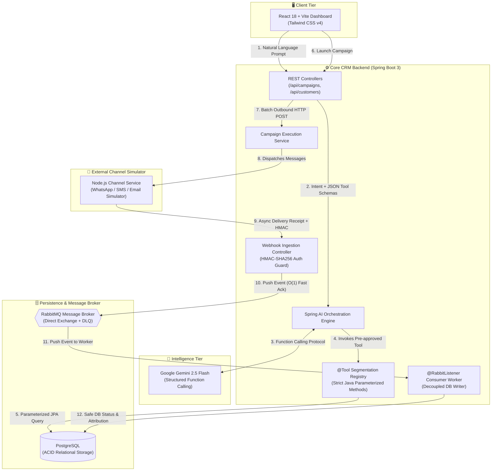
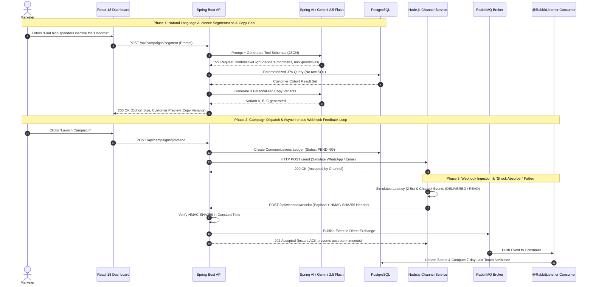

# 🚀 AI-Native Mini CRM & Communication Engine

[](https://www.oracle.com/java/)
[](https://spring.io/projects/spring-boot)
[](https://spring.io/projects/spring-ai)
[](https://www.postgresql.org/)
[](https://www.rabbitmq.com/)
[](https://react.dev/)
[](https://tailwindcss.com/)

An enterprise-ready, AI-native Customer Relationship Management (CRM) platform and high-throughput communication engine. Built to eliminate the friction of traditional query builders by translating natural language marketing intent into deterministic database operations, backed by an event-driven asynchronous webhook ingestion pipeline.

---

## 🏗️ High-Level System Architecture

The platform is designed around a decoupled, microservices-inspired architecture that separates user interaction, AI semantic reasoning, transactional persistence, external channel simulation, and high-volume event ingestion.



---

## 🔄 End-to-End Request Flow

The system operates across two critical workflows: **AI-Powered Audience Segmentation** and **Event-Driven Delivery & Ingestion**.



---

## 💡 Core Engineering Pillars

### 1. Deterministic AI via Spring AI Function Calling (`@Tool`)
* **The Problem:** Naive Text-to-SQL allows LLMs to write raw SQL directly against the database, opening severe risks of SQL injection, schema corruption, and hallucinations.
* **The Solution:** The LLM is confined strictly to an application-level **semantic router**. Spring AI dynamically converts Java methods annotated with `@Tool` into JSON schemas for Gemini. The LLM selects the correct tool and parameters; our backend executes strictly parameterized Spring Data JPA queries. **Zero raw SQL is ever executed by the LLM.**

### 2. The "Shock Absorber" Webhook Ingestion (RabbitMQ)
* **The Problem:** Disagreeing network speeds and bulk campaigns (e.g., 50,000 messages) cause thousands of delivery receipts to return simultaneously, leading to database connection pool starvation and crashes.
* **The Solution:** The webhook intake endpoint (`POST /api/webhook/receipt`) performs only lightweight validation and immediately pushes the payload to **RabbitMQ**, returning `202 Accepted` in sub-10ms. A background `@RabbitListener` consumes events at a controlled rate, with a **Dead-Letter Queue (DLQ)** to isolate poisoned messages without blocking the pipeline.

### 3. Cryptographic Webhook Security (HMAC-SHA256)
* The webhook endpoint is secured using **HMAC-SHA256 signatures** (`X-Hub-Signature-256`).
* The payload is hashed with a shared symmetric secret on the provider side. The Spring Boot backend recalculates the hash and compares it using constant-time byte equality, guaranteeing **authenticity** (verifying the sender) and **data integrity** (detecting tampering in transit) without exposing secrets over the wire.

### 4. Financial-Grade Attribution & Ingestion
* **`BigDecimal` Precision:** Order values and monetary calculations avoid IEEE 754 binary floating-point drift.
* **7-Day Last-Touch Attribution:** Orders occurring within 7 days of campaign delivery are deterministically attributed to the specific communication and campaign.
* **Transactional Bulk Ingestion:** Supports single and CSV file uploads with strict Jakarta validation wrapped in `@Transactional` rollback guarantees.

---

## 🛠️ Tech Stack Breakdown

| Layer | Technologies | Key Responsibility |
|---|---|---|
| **Frontend** | React 18, Vite, Tailwind CSS v4, Lucide Icons | Dark-mode SaaS UI, real-time KPI metrics, AI prompt builder |
| **Backend Core** | Java 17, Spring Boot 3.2, Spring Data JPA | REST APIs, business logic, entity management, security |
| **AI Layer** | Spring AI, Google Gemini 2.5 Flash | Natural language translation, tool selection, copy drafting |
| **Messaging** | RabbitMQ (AMQP 0-9-1), Spring AMQP | Asynchronous webhook queuing, load leveling, DLQ |
| **Database** | PostgreSQL | Relational storage (Customers, Orders, Campaigns, Communications) |
| **Simulator** | Node.js, Express, Crypto | Simulates external vendor dispatch, backoff retries, webhook dispatch |

---

## 🚀 Getting Started Locally

### Prerequisites
* Java 17+
* Node.js 18+
* PostgreSQL (Running on port 5432)
* RabbitMQ (Local server or CloudAMQP instance)
* Gemini API Key

### 1. Spring Boot Backend
Navigate to `Xeno Backend` and start the server:
```bash
cd "Xeno Backend"
./mvnw spring-boot:run
```
*(Automatically seeds mock customer and order records on first boot).*

### 2. Node.js Channel Simulator
Navigate to `Xeno Channel Service` and start the mock provider:
```bash
cd "Xeno Channel Service"
npm install
npm start
```
*(Runs on port 3001, listening for dispatches and returning signed webhooks).*

### 3. React Frontend Dashboard
Navigate to `Frontend Xeno` and start the Vite dev server:
```bash
cd "Frontend Xeno"
npm install
npm run dev
```
*(Open `http://localhost:5173` in your browser).*

---

*Architected with focus on scalability, security, and deterministic AI systems.*
